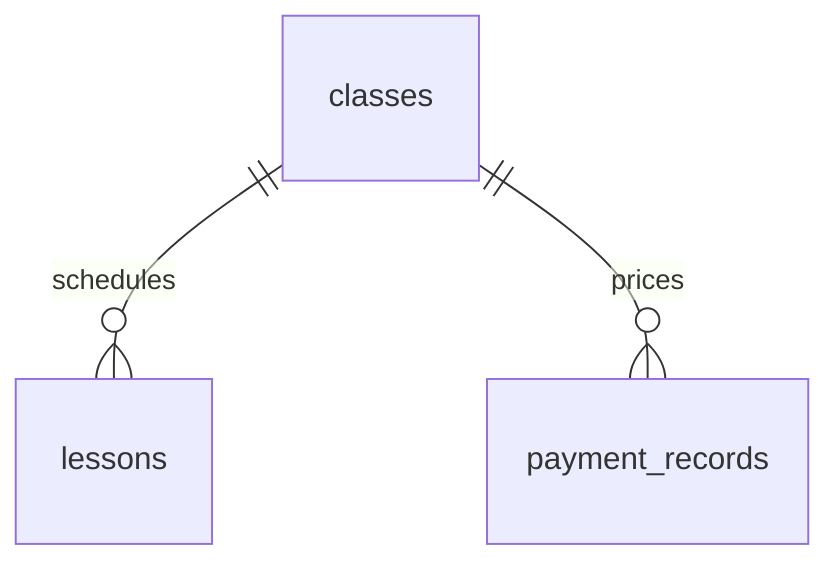

# `classes` テーブル仕様書

## 1. 目的

`classes` は、授業予定（`lessons`）と支払い記録（`payment_records`）から参照するクラス料金マスタである。授業を実施する日時は `lessons` が管理し、クラス名・レベル・授業時間・料金は本テーブルが管理する。

## 2. テーブル概要

| 項目 | 内容 |
| --- | --- |
| テーブル名 | `classes` |
| 主キー | `id`（UUID） |
| 参照元 | `lessons.class_id`、`payment_records.class_id` |
| 削除方針 | 物理削除しない。`DELETE /classes/:classId` は `is_active=false` にする |
| 金額 | 最小通貨単位の整数（日本円なら円） |

## 3. カラム定義

| カラム | PostgreSQL型 | NULL | デフォルト | 制約・用途 |
| --- | --- | :---: | --- | --- |
| `id` | `uuid` | NO | `gen_random_uuid()` | 主キー |
| `name` | `varchar(120)` | NO | なし | クラス名。アクティブなクラス間で一意 |
| `level` | `varchar(30)` | YES | `NULL` | 初級・中級などの表示用レベル |
| `duration_minutes` | `integer` | NO | なし | 授業時間。正の整数 |
| `price_minor` | `integer` | NO | なし | 5回分チケットの1回あたり料金 |
| `currency` | `varchar(3)` | NO | `JPY` | ISO 4217コード |
| `is_active` | `boolean` | NO | `true` | 新規授業・購入で選択可能か |
| `created_at` | `timestamptz` | NO | `now()` | 登録日時 |
| `updated_at` | `timestamptz` | NO | `now()` | 最終更新日時 |

## 4. 関係と利用ルール

- `lessons.class_id` は必須。授業予定は必ずクラスを1つ参照する。
- `payment_records.class_id` は必須。購入時点の料金は支払い記録側の金額スナップショットへ保存する。
- クラスの料金・時間を変更しても、過去の支払い記録の金額や授業予定の表示スナップショットを変更しない。
- 非アクティブ化したクラスは、新しい授業予定・支払い記録では選択できない。ただし既存データの参照は許可する。
- `lessons` や `payment_records` から参照されているクラスを削除しない。APIは論理削除として非アクティブ化する。

## 5. 移行方針

Migration `0009_ordinary_firelord.sql` で、旧 `lesson_types` テーブルを `classes` にリネームし、`lessons.lesson_type_id` と `payment_records.lesson_type_id` をそれぞれ `class_id` にリネームした。既存のUUID・料金・関連データは保持する。

アプリケーションAPIでは旧名称を公開せず、次の名前を使用する。

- クラスマスタ: `/api/v1/classes`
- 授業予定の参照項目: `lessons[].classId`
- 支払い記録の参照項目: `paymentRecords[].classId`
- 支払い記録の表示名: `paymentRecords[].className`

内部コードには段階移行用の互換エイリアスが残る場合があるが、新規実装では `classes`、`classId`、`className` を使用する。
