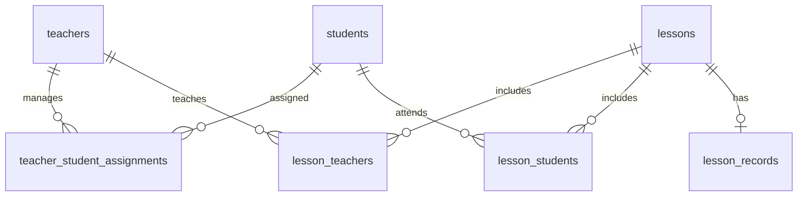
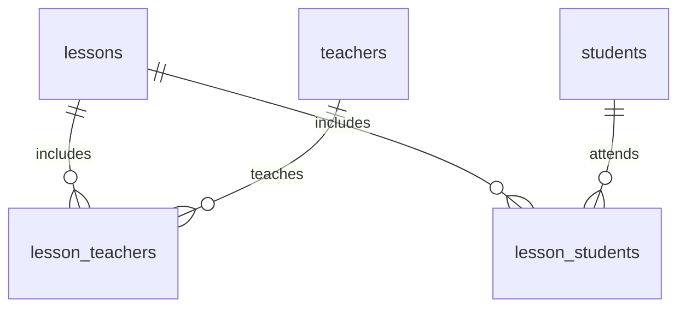

# 追加テーブル候補・スキーマ設計書

## 1. 文書の目的

現在のDB構成（`teachers`、`students`、`lessons`、`lesson_records`）から、ユーザー・担当関係・複数参加者対応へ拡張するためのテーブル候補とスキーマ案を整理する。

この文書は設計検討用であり、ここに記載したテーブルはまだ作成しない。実装する際は、対象機能の画面・API・業務ルールを確定した後に、個別のテーブル仕様書とMigrationを追加する。

## 2. 現在のテーブル構成

詳細な目標ER図は [テーブル関連図](./table-relationships.md) を参照する。



現在の構成で応募用MVPの主要フローは成立する。

1. 生徒と講師を登録する
2. 講師と生徒の担当関係を登録する
3. 複数講師・複数生徒のレッスン予定を登録する
4. レッスン全体の授業実績を記録する
5. 講師別・月別に集計する

## 3. 追加候補の優先順位

| 優先度 | テーブル | 目的 | 作成タイミング |
| :---: | --- | --- | --- |
| A | `lesson_types` | レッスン名・標準時間・レベルをマスタ化 | レッスン登録の選択肢を固定したい時 |
| A | `users` | ログイン主体を管理 | デモログインまたは認証を追加する時 |
| A | `user_roles` | ユーザーの権限を管理 | representative / teacher / staffを導入する時 |
| A | `staff_members` | スタッフの業務プロフィールを管理 | スタッフ固有の属性が必要になった時 |
| A | `teacher_student_assignments` | 講師の担当生徒を管理 | 講師ごとの表示範囲を制限する時 |
| A | `lesson_teachers` | レッスンと講師の中間テーブル | 複数講師に対応する時 |
| A | `lesson_students` | レッスンと生徒の中間テーブル | 複数生徒・個別出欠に対応する時 |
| B | `audit_logs` | 作成・更新・状態変更の履歴を残す | 公開デモの操作履歴や運用性を見せる時 |
| B | `teacher_availabilities` | 講師の対応可能時間を管理 | 予定の重複・空き時間チェックを実装する時 |
| B | `student_enrollments` | 生徒の受講コース・在籍期間を管理 | コース単位の在籍管理が必要になった時 |
| C | `payments` | 受講料・支払い状況を管理 | 支払い管理をMVPへ追加する時 |
| C | `rooms` | 教室・オンラインルームを管理 | 教室割当や設備管理が必要になった時 |
| C | `leave_requests` | 講師・スタッフの休暇申請を管理 | 勤怠・承認フローを追加する時 |

## 4. 優先度A：レッスン種別マスタ

### 4.1 `lesson_types`

現在の `lessons.title` と `lessons.level` は自由入力である。レッスンの選択肢や標準時間を管理する必要が出た場合、`lesson_types` を追加してレッスン登録時に参照する。

| カラム | PostgreSQL型 | NULL | 制約・用途 |
| --- | --- | :---: | --- |
| `id` | `uuid` | NO | PK。`gen_random_uuid()` |
| `name` | `varchar(150)` | NO | レッスン種別名 |
| `level` | `varchar(30)` | YES | `beginner`、`intermediate`、`advanced` など |
| `default_duration_minutes` | `smallint` | NO | 1〜480分 |
| `description` | `text` | YES | 管理用説明 |
| `is_active` | `boolean` | NO | デフォルト `true` |
| `created_at` | `timestamptz` | NO | デフォルト `now()` |
| `updated_at` | `timestamptz` | NO | 更新時に更新 |

### 4.2 `lessons` との関係

```text
lesson_types 1 ─── * lessons
```

追加時は `lessons.lesson_type_id` を追加する。既存の `title` と `level` は、履歴表示を壊さないため次のどちらかを選ぶ。

- `title` と `level` をスナップショットとして残し、`lesson_type_id` も保持する（推奨）
- `title` と `level` を削除して、常にマスタを参照する

過去レッスンを後から正しく表示する必要があるため、MVPでは前者を推奨する。

## 5. 優先度A：認証・操作主体

### 5.1 `users`、`user_roles`、`staff_members`

ログイン・権限管理を追加する場合の操作主体と業務プロフィール。認証プロバイダのユーザー情報は `users` に紐付け、権限は `user_roles`、スタッフ固有の情報は `staff_members` に分ける。

| カラム | PostgreSQL型 | NULL | 制約・用途 |
| --- | --- | :---: | --- |
| `users.id` | `uuid` | NO | PK |
| `users.external_user_id` | `varchar(255)` | YES | 認証プロバイダ側のユーザーID。UNIQUE |
| `users.email` | `varchar(255)` | NO | 認証プロバイダから同期 |
| `users.display_name` | `varchar(100)` | NO | ログイン後の表示名 |
| `user_roles.user_id` | `uuid` | NO | `users.id` へのFK |
| `user_roles.role` | `user_role` | NO | `representative`、`teacher`、`staff`。1ユーザー1ロール |
| `teachers.user_id` | `uuid` | YES | `users.id` への一意FK |
| `staff_members.user_id` | `uuid` | YES | `users.id` への一意FK |

### 5.2 方針

- パスワードやセッションを自前のテーブルに保存しない。
- 認証プロバイダのIDとアプリ内の権限だけを保持する。
- `users` や `staff_members` を追加しただけでは認証にならない。APIの認証ミドルウェアと認可チェックが必要。
- `audit_logs.actor_id` は将来 `users.id` を参照する。

## 5.3 `teacher_student_assignments`

講師の担当生徒を管理する。レッスン履歴ではなく、現在の担当範囲をAPIの認可条件に使う。

| カラム | PostgreSQL型 | NULL | 制約・用途 |
| --- | --- | --- | --- |
| `id` | `uuid` | NO | PK |
| `teacher_id` | `uuid` | NO | FK → `teachers.id` |
| `student_id` | `uuid` | NO | FK → `students.id` |
| `is_active` | `boolean` | NO | 現在の担当状態 |
| `assigned_at` | `timestamptz` | NO | 担当開始日時 |
| `ended_at` | `timestamptz` | YES | 担当終了日時 |

`teacher_id`、`student_id`、`is_active` にIndexを作成し、有効な担当関係の重複を防止する。

## 5.4 `lesson_teachers` と `lesson_students`

`lessons` の直接FKを置き換える中間テーブルである。



- `lesson_teachers` は `(lesson_id, teacher_id)` を一意にする。
- `lesson_teachers.role` は `primary` または `assistant` とする。
- `lesson_students` は `(lesson_id, student_id)` を一意にする。
- 生徒ごとの出欠は `lesson_students.participation_status` に保存する。
- 授業メモと次回内容は、当面 `lesson_records` にレッスン単位で保存する。

## 6. 優先度B：監査ログ

### 6.1 `audit_logs`

レッスン状態変更、生徒・講師の更新など、誰が何を変更したかを記録する。認証導入後に追加する。

| カラム | PostgreSQL型 | NULL | 制約・用途 |
| --- | --- | :---: | --- |
| `id` | `uuid` | NO | PK |
| `actor_id` | `uuid` | YES | FK → `users.id`。システム処理はNULL可 |
| `action` | `varchar(50)` | NO | `create`、`update`、`archive` など |
| `resource_type` | `varchar(50)` | NO | `students`、`teachers`、`lessons` など |
| `resource_id` | `uuid` | NO | 変更対象のID。多態参照のためDB FKは張らない |
| `before_data` | `jsonb` | YES | 変更前の公開可能な値 |
| `after_data` | `jsonb` | YES | 変更後の公開可能な値 |
| `request_id` | `varchar(100)` | YES | APIリクエストとの紐付け |
| `created_at` | `timestamptz` | NO | デフォルト `now()`。更新不可 |

### 6.2 方針

- パスワード、トークン、決済情報などの機密値は記録しない。
- `resource_type` と `resource_id` の組み合わせで対象を特定する。
- ログは原則追記のみとし、通常のCRUDから更新・削除しない。
- 大量化した場合は保持期間とアーカイブ方針を決める。

## 7. 優先度B：講師の対応可能時間

### 7.1 `teacher_availabilities`

講師が授業を担当できる時間帯を曜日・時間帯で表す。レッスンの重複チェックだけなら現在の `lessons` で足りるため、空き時間を管理する要件が出るまで作成しない。

| カラム | PostgreSQL型 | NULL | 制約・用途 |
| --- | --- | :---: | --- |
| `id` | `uuid` | NO | PK |
| `teacher_id` | `uuid` | NO | FK → `teachers.id`。削除時 `CASCADE` |
| `day_of_week` | `smallint` | NO | 0〜6。タイムゾーン基準を別途固定 |
| `start_time` | `time` | NO | 対応開始時刻 |
| `end_time` | `time` | NO | 対応終了時刻。開始より後 |
| `valid_from` | `date` | YES | 適用開始日 |
| `valid_to` | `date` | YES | 適用終了日 |
| `is_active` | `boolean` | NO | デフォルト `true` |
| `created_at` | `timestamptz` | NO | デフォルト `now()` |
| `updated_at` | `timestamptz` | NO | 更新時に更新 |

### 7.2 注意点

- `day_of_week` の0が日曜か月曜かをAPI・画面・DBで統一する。
- `Asia/Taipei` を基準にするか、講師ごとのタイムゾーンを持つかを決める。
- 同じ講師の対応可能時間が重複しないよう、APIまたは排他制約で検証する。

## 8. 優先度B：生徒の受講・在籍情報

### 8.1 `student_enrollments`

生徒がどのコース・プランにいつ在籍しているかを管理する。現在の `students.level` は生徒の現在値であり、受講履歴を表すものではない。

このテーブルを作る場合は、先に `courses` または `lesson_types` のどちらをコースマスタとして利用するか決める。

| カラム | PostgreSQL型 | NULL | 制約・用途 |
| --- | --- | :---: | --- |
| `id` | `uuid` | NO | PK |
| `student_id` | `uuid` | NO | FK → `students.id` |
| `course_id` | `uuid` | NO | FK → 将来の `courses.id` |
| `started_on` | `date` | NO | 在籍開始日 |
| `ended_on` | `date` | YES | 在籍終了日。開始日以降 |
| `status` | `enrollment_status` | NO | `active`、`paused`、`completed`、`withdrawn` |
| `note` | `text` | YES | 管理用メモ。個人情報を書きすぎない |
| `created_at` | `timestamptz` | NO | デフォルト `now()` |
| `updated_at` | `timestamptz` | NO | 更新時に更新 |

### 8.2 `students.level` との関係

- `students.level` は現在の一覧表示用の簡易属性として残せる。
- コース在籍履歴のレベルは `student_enrollments` または別の進捗テーブルで管理する。
- 過去レッスンのレベルは既存の `lessons.level` スナップショットを正とする。

## 9. 優先度C：支払い

### 9.1 `payments`

支払い管理は、単独の `payments` だけではなく、教科書・レッスンの請求明細を固定する必要がある。詳細な採用案は [支払い記録向けスキーマ仕様書](./payment-materials-schema-spec.md) を参照する。

| カラム | PostgreSQL型 | NULL | 制約・用途 |
| --- | --- | :---: | --- |
| `id` | `uuid` | NO | PK |
| `student_id` | `uuid` | NO | FK → `students.id` |
| `amount_minor` | `integer` | NO | 最小通貨単位の整数。0より大きい |
| `currency` | `char(3)` | NO | ISO 4217。例：`TWD`、`JPY` |
| `status` | `payment_status` | NO | `pending`、`paid`、`refunded`、`voided` |
| `paid_at` | `timestamptz` | YES | 支払完了日時 |
| `external_payment_id` | `varchar(255)` | YES | 外部決済サービスのID。UNIQUE |
| `note` | `text` | YES | 管理用メモ |
| `created_at` | `timestamptz` | NO | デフォルト `now()` |
| `updated_at` | `timestamptz` | NO | 更新時に更新 |

### 9.2 方針

- 金額を浮動小数点で保存しない。
- カード番号・セキュリティコードを保存しない。
- 決済サービスのWebhookや返金フローまで含めて設計できる時に作成する。
- 支払いとレッスン・教科書の対応関係は、`billing_records` と `billing_items` を間に置いて管理する。`payments` から直接 `lessons` を参照しない。

## 10. 優先度C：教室・オンラインルーム

### 10.1 `rooms`

対面授業の教室やオンライン授業のURLを管理する場合の候補。

| カラム | PostgreSQL型 | NULL | 制約・用途 |
| --- | --- | :---: | --- |
| `id` | `uuid` | NO | PK |
| `name` | `varchar(100)` | NO | 教室名またはルーム名 |
| `room_type` | `varchar(20)` | NO | `physical` または `online` |
| `location` | `varchar(255)` | YES | 教室の場所 |
| `join_url` | `text` | YES | オンライン参加URL。公開ログに出さない |
| `capacity` | `smallint` | YES | 定員 |
| `is_active` | `boolean` | NO | デフォルト `true` |
| `created_at` | `timestamptz` | NO | デフォルト `now()` |
| `updated_at` | `timestamptz` | NO | 更新時に更新 |

追加時は `lessons.room_id` をNULL許可で追加し、既存のレッスンには一括設定しない。

## 11. 優先度C：休暇申請

### 11.1 `leave_requests`

講師・スタッフの休暇申請と承認を管理する。生徒の欠席や授業キャンセルとは別の業務概念なので、`lessons` や `lesson_records` に統合しない。

| カラム | PostgreSQL型 | NULL | 制約・用途 |
| --- | --- | :---: | --- |
| `id` | `uuid` | NO | PK |
| `staff_user_id` | `uuid` | NO | FK → `staff_users.id` |
| `start_on` | `date` | NO | 休暇開始日 |
| `end_on` | `date` | NO | 休暇終了日。開始日以降 |
| `leave_type` | `varchar(30)` | NO | 有給・病欠など。制度確定後にマスタ化 |
| `status` | `leave_request_status` | NO | `draft`、`submitted`、`approved`、`rejected`、`cancelled` |
| `reason` | `text` | YES | 申請理由。個人情報の扱いに注意 |
| `approved_by` | `uuid` | YES | FK → `staff_users.id` |
| `approved_at` | `timestamptz` | YES | 承認日時 |
| `created_at` | `timestamptz` | NO | デフォルト `now()` |
| `updated_at` | `timestamptz` | NO | 更新時に更新 |

## 12. 今すぐ作らないテーブル

現時点では、次のテーブルは追加しない。

- `staff_users`：ログイン・認可を実装する予定が未確定のため
- `audit_logs`：誰が操作したかを識別する認証が未導入のため
- `teacher_availabilities`：空き時間管理の画面・業務ルールが未確定のため
- `student_enrollments`：コース概念が未確定のため
- `payments`：支払業務・決済サービスの対象範囲が未確定のため
- `rooms`：教室割当の要件がないため
- `leave_requests`：勤怠・承認機能がMVP対象外のため

## 13. 次に追加するなら

応募用MVPの範囲では、既存の4テーブルでまず生徒・講師・レッスン・授業実績の一連の業務を完成させる。

次に追加する候補は、レッスン登録の選択肢を安定させる `lesson_types` である。ただし、現在の `title` で十分にデモできる間は作成せず、自由入力による不整合が実際に問題になった時点で追加する。
