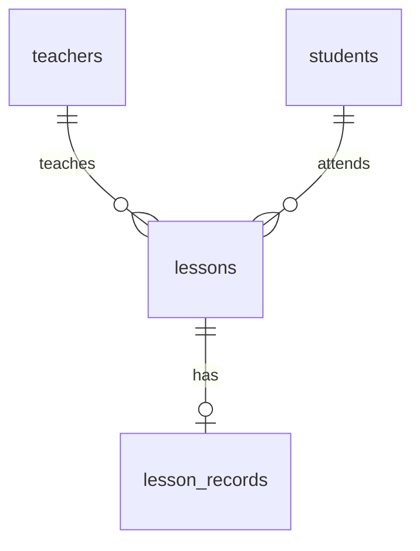
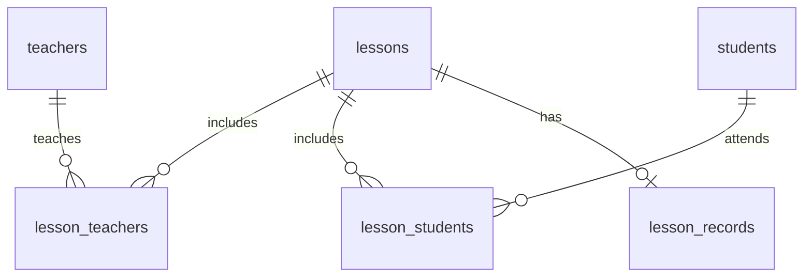

# `lessons` テーブル仕様書

## 1. 目的

授業を実施する日時と現在の業務状態を管理する。クラスの定義や料金は [classes テーブル仕様書](./classes-table-spec.md) で管理し、本テーブルはクラスを参照する。

現在の実装では `teacher_id` と `student_id` を直接保持する。複数講師・複数生徒へ移行した後は、これらを `lesson_teachers` と `lesson_students` へ移す。全体の関係は [テーブル関連図](./table-relationships.md) を参照する。

## 2. テーブル概要

| 項目 | 内容 |
| --- | --- |
| テーブル名 | `lessons` |
| 主キー | `id`（UUID） |
| 参照先 | `teachers.id`、`students.id`、`classes.id` |
| 被参照元 | `lesson_records.lesson_id` |
| 時刻 | `timestamptz`。UTC保存、表示は `Asia/Taipei` |
| 削除方針 | 物理削除しない。`DELETE /lessons/:lessonId` は `status=cancelled` に更新する |

## 3. カラム定義

| カラム | PostgreSQL型 | NULL | デフォルト | 制約・用途 |
| --- | --- | :---: | --- | --- |
| `id` | `uuid` | NO | `gen_random_uuid()` | 主キー |
| `teacher_id` | `uuid` | NO | なし | `teachers.id` へのFK。削除時 `RESTRICT` |
| `student_id` | `uuid` | NO | なし | `students.id` へのFK。削除時 `RESTRICT` |
| `class_id` | `uuid` | NO | なし | `classes.id` へのFK。削除時 `RESTRICT` |
| `title` | `varchar(150)` | NO | なし | レッスン内容または表示名 |
| `level` | `varchar(30)` | YES | `NULL` | レッスン時点のレベルのスナップショット |
| `scheduled_start_at` | `timestamptz` | NO | なし | 予定開始日時 |
| `scheduled_end_at` | `timestamptz` | NO | なし | 予定終了日時。開始より後 |
| `status` | `lesson_status` | NO | `scheduled` | レッスン状態 |
| `status_reason` | `text` | YES | `NULL` | 欠席・キャンセル理由など |
| `created_at` | `timestamptz` | NO | `now()` | 登録日時 |
| `updated_at` | `timestamptz` | NO | `now()` | 最終更新日時 |

## 4. `status` の値

| 値 | 意味 | `lesson_records` | 実施時間集計 |
| --- | --- | --- | --- |
| `scheduled` | 予定 | なし | 対象外 |
| `completed` | 実施済み | 必須 | 対象 |
| `absent` | 欠席 | なし | 対象外 |
| `cancelled` | キャンセル | なし | 対象外 |

内部値は英語で保存し、画面表示はi18n辞書で日本語・繁体字中国語へ変換する。

## 5. DB制約・インデックス

- `scheduled_end_at > scheduled_start_at`
- `teacher_id` は存在する講師を参照する
- `student_id` は存在する生徒を参照する
- `status` は `lesson_status` enumの値だけを許可する
- `scheduled_start_at`：期間検索用
- `(teacher_id, scheduled_start_at)`：講師別一覧・集計用
- `(status, scheduled_start_at)`：状態別一覧用
- `(student_id, scheduled_start_at)`：生徒別履歴用

## 6. 状態更新ルール

| 現在 | 更新先 | MVP |
| --- | --- | :---: |
| `scheduled` | `completed` | 許可 |
| `scheduled` | `absent` | 許可 |
| `scheduled` | `cancelled` | 許可 |
| `absent` / `cancelled` | `completed` | 訂正用途で許可 |
| `completed` | `scheduled` | 原則不許可 |

`completed` へ更新する場合は、実績の開始・終了日時を同じトランザクションで保存する。状態変更はAPIで検証し、フロントエンドだけに依存しない。

## 7. 作成・更新時のルール

- 作成時の状態は `scheduled` 固定。
- `teacher_id`、`student_id`、`class_id` は有効なマスタを参照する。
- 非アクティブなクラスは新規授業予定に指定できない。既存予定では参照を維持する。
- `title` は空文字を拒否する。
- 予定終了日時は予定開始日時より後にする。
- `completed` 以外では実施時間を集計しない。
- `status_reason` は欠席・キャンセル時に使用する。
- `updated_at` は更新処理で現在時刻へ更新する。
- レッスン削除は物理削除せず、`scheduled` の場合だけ `cancelled` へ更新する。
- `completed`、`absent`、`cancelled` のレッスンは、授業実績API実装後の訂正フローを使う。

## 8. 集計上の扱い

月次集計の月は、`scheduled_start_at` を `Asia/Taipei` に変換した月で判定する。

- 授業件数：全状態を含む
- 実施件数：`completed` のみ
- 実施時間：紐付く `lesson_records` の実施終了−開始
- 欠席件数：`absent` のみ
- キャンセル件数：`cancelled` のみ

## 9. 複数参加者モデルへの移行

目標構成では、次の中間テーブルで参加者を管理する。

`lessons` は予定・状態を持ち、講師と生徒の配列は中間テーブルから取得する。授業メモと次回内容は当面 `lesson_records` にレッスン単位で保存し、生徒別記録は追加しない。
