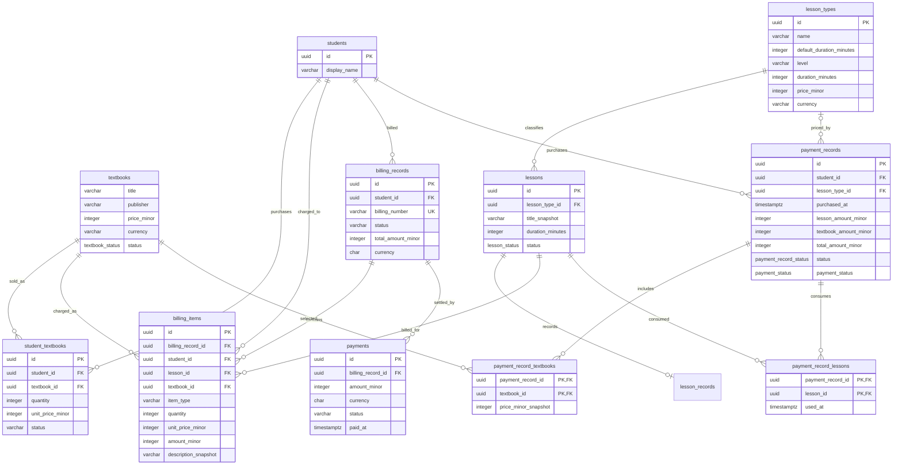

# 支払い記録向けスキーマ仕様書（検討案）

## 1. 目的

教科書代とレッスン料を、生徒単位の支払い記録として正確に残すためのDB設計案を定義する。

この文書は、画面に表示するレッスン種別・教科書と、生徒ごとの支払い記録を定義する。現在の実装対象は `lesson_types`、`textbooks`、`payment_records`、`payment_record_textbooks`、`payment_record_lessons` である。請求書発行や外部決済連携は次段階とする。

## 2. 結論

次の責務を分ける。

| 責務 | テーブル | 役割 |
| --- | --- | --- |
| 教科書マスタ | `textbooks` | 教科書名・出版社・価格・販売状態を管理。今回実装 |
| 生徒が購入した教科書 | `student_textbooks` | 次段階。生徒への販売・利用状況を管理 |
| レッスン種別マスタ | `lesson_types` | レッスン名・レベル・時間・料金を管理。今回実装 |
| レッスン実績 | `lessons` / `lesson_records` | 予定・実施時間・授業内容を管理 |
| 支払い記録 | `payment_records` | 生徒ごとの5レッスン分の購入記録と合計金額。今回実装 |
| 支払い教科書 | `payment_record_textbooks` | 1支払いに複数教科書を紐付け。今回実装 |
| 利用レッスン | `payment_record_lessons` | 消化したレッスンを紐付け、残り回数を算出。今回実装 |
| 請求単位 | `billing_records` | 次段階。生徒ごとの請求書・支払い記録の親 |
| 請求明細 | `billing_items` | 次段階。レッスン料・教科書代を金額確定時点で保存 |
| 入金記録 | `payments` | 次段階。実際の支払・返金・取消を記録 |

`payments` から直接 `lessons` や `textbooks` を参照するだけでは、価格改定や一括請求に弱い。そのため、将来は `billing_records` と `billing_items` を追加する。今回のSeedでは、5件の支払い記録、6件の教科書紐付け、5件の利用レッスン紐付けまでを行う。

## 3.1 今回の実装範囲

- `lesson_types`：5件
- `textbooks`：5件
- `lessons.lesson_type_id`：既存5レッスンへ設定
- `payment_records`：5件
- `payment_record_textbooks`：6件。1支払いに複数教科書を紐付け可能
- `payment_record_lessons`：5件。利用済みレッスンを紐付け
- `billing_records`、`billing_items`、`payments`：未実装
- `student_textbooks`：未実装。教科書の購入記録が必要になった段階で追加

## 3.2 5レッスン固定の計算ルール

チケット枚数やチケット単位の情報は保存しない。1件の `payment_records` は常に5回分のレッスン利用権を表す。

```text
lessonAmountMinor = lessonType.priceMinor × 5
textbookAmountMinor = 紐付く教科書の priceMinor の合計
totalAmountMinor = lessonAmountMinor + textbookAmountMinor
remainingLessons = 5 - payment_record_lessons の件数
```

## 3.3 支払い状態

利用状態と支払い状態を分けて保持する。

| カラム | 値 | 意味 |
| --- | --- | --- |
| `status` | `active` / `used_up` / `expired` / `cancelled` | レッスン利用状態 |
| `payment_status` | `unpaid` / `paid` / `refunded` | 支払い状態 |

利用状態は利用レッスン数から再計算できるが、一覧表示を簡単にするため現在の状態も保存し、利用紐付け時に更新する。

## 3. ER図



## 4. `textbooks` 教科書マスタ

### 4.1 役割

教科書そのものの情報を管理する。価格は表示・販売用の標準価格であり、実際の請求価格は将来 `billing_items` にコピーして確定する。

| カラム | 型 | NULL | 制約・用途 |
| --- | --- | :---: | --- |
| `id` | `uuid` | NO | PK |
| `code` | `varchar(50)` | NO | 教材コード。UNIQUE。例 `TEXT-GRAMMAR-01` |
| `title` | `varchar(200)` | NO | 教科書名 |
| `publisher` | `varchar(150)` | NO | 出版社 |
| `price_minor` | `integer` | NO | 標準単価。最小通貨単位の整数 |
| `currency` | `varchar(3)` | NO | ISO 4217。Seedは `JPY` |
| `status` | `textbook_status` | NO | `selling` / `discontinued` |
| `created_at` / `updated_at` | `timestamptz` | NO | 監査用日時 |

### 4.2 ルール

- 教科書を物理削除しない。販売停止は `is_active = false` とする。
- `price_minor >= 0`。無料教材も扱える。
- 販売終了は削除ではなく `status = discontinued` とする。
- 詳細な在庫・購入履歴は今回管理しない。

## 5. `student_textbooks` 生徒別教科書

教科書マスタと生徒の購入・配布履歴を結ぶ。単に「この生徒が使う教科書」を表すだけでなく、支払い対象となった数量と単価を残す。

| カラム | 型 | NULL | 制約・用途 |
| --- | --- | :---: | --- |
| `id` | `uuid` | NO | PK |
| `student_id` | `uuid` | NO | FK → `students.id`。削除時 `RESTRICT` |
| `textbook_id` | `uuid` | NO | FK → `textbooks.id`。削除時 `RESTRICT` |
| `quantity` | `integer` | NO | 1以上 |
| `unit_price_minor` | `integer` | NO | 生徒へ適用した単価 |
| `currency` | `char(3)` | NO | 請求時の通貨 |
| `status` | `varchar(20)` | NO | `reserved` / `issued` / `returned` |
| `issued_at` | `timestamptz` | YES | 引渡日時 |
| `note` | `text` | YES | 管理用メモ |
| `created_at` / `updated_at` | `timestamptz` | NO | 監査用日時 |

同一購入を複数回に分ける可能性があるため、`student_id` と `textbook_id` の単純な一意制約は付けない。

## 6. `lesson_types` レッスン種別マスタ

現在の `lessons.title` と `lessons.level` はレッスンごとの表示情報である。画面に表示する料金表を安定して管理するため、`lesson_types` を追加する。

| カラム | 型 | NULL | 制約・用途 |
| --- | --- | :---: | --- |
| `id` | `uuid` | NO | PK |
| `name` | `varchar(150)` | NO | 画面表示名 |
| `level` | `varchar(30)` | NO | `全レベル`、`intermediate以上` など |
| `duration_minutes` | `integer` | NO | 標準時間。1〜480分 |
| `price_minor` | `integer` | NO | レッスン料金 |
| `currency` | `varchar(3)` | NO | ISO 4217。Seedは `JPY` |
| `is_active` | `boolean` | NO | 選択候補への表示可否 |
| `created_at` / `updated_at` | `timestamptz` | NO | 監査用日時 |

### 6.1 レッスンへの反映

`lessons.lesson_type_id` をNULL許可で追加し、既存の `title`、`level` は履歴表示用のスナップショットとして残す。

今回の `lessons` には `lesson_type_id` のみ追加する。レッスン種別の料金を後から変更しても、既存レッスンの表示名・レベル・予定時間は既存の値を利用できる。請求機能を実装する段階で、必要なら料金スナップショットを `billing_items` に保存する。

最終的な請求額は将来 `billing_items` にコピーし、マスタ変更の影響を受けないようにする。

## 7. `lessons` に持たせるべき情報

現在のレッスン構造を支払い対応へ拡張する場合、次をレッスン本体に持たせる。

- 予定：`scheduled_start_at`、`scheduled_end_at`
- 実績：`lesson_records.actual_start_at`、`actual_end_at`
- 実施状態：`status`
- 参加者：`lesson_teachers`、`lesson_students`
- 料金計算の元情報：`lesson_type_id`。種別側に時間・料金を保持する

複数生徒のグループレッスンでは、1件の `lessons` に対して生徒ごとに `billing_items` を作成する。講師が複数いても、講師ごとの支払いが別要件でない限り、レッスン料の明細は分割しない。

## 8. `billing_records` 請求記録

生徒・請求期間ごとの請求の親レコード。支払いの前提となる請求額を管理する。

| カラム | 型 | NULL | 制約・用途 |
| --- | --- | :---: | --- |
| `id` | `uuid` | NO | PK |
| `student_id` | `uuid` | NO | FK → `students.id` |
| `billing_number` | `varchar(50)` | NO | UNIQUE。画面表示用の請求番号 |
| `period_start` / `period_end` | `date` | NO | 請求対象期間。終了日は含まない |
| `status` | `varchar(20)` | NO | `draft` / `issued` / `partially_paid` / `paid` / `voided` |
| `subtotal_amount_minor` | `integer` | NO | 税抜小計または税計算前小計 |
| `tax_amount_minor` | `integer` | NO | 税額 |
| `total_amount_minor` | `integer` | NO | 請求合計 |
| `currency` | `char(3)` | NO | 請求通貨 |
| `issued_at` | `timestamptz` | YES | 発行日時 |
| `due_at` | `timestamptz` | YES | 支払期限 |
| `created_at` / `updated_at` | `timestamptz` | NO | 監査用日時 |

`issued` 以降は明細の単価・数量・税額を変更しない。訂正は取消または差額調整の明細で行う。

## 9. `billing_items` 請求明細

レッスン料と教科書代を同じ請求に混在させるための明細テーブル。

| カラム | 型 | NULL | 制約・用途 |
| --- | --- | :---: | --- |
| `id` | `uuid` | NO | PK |
| `billing_record_id` | `uuid` | NO | FK → `billing_records.id` |
| `student_id` | `uuid` | NO | FK → `students.id`。請求親と一致させる |
| `item_type` | `varchar(20)` | NO | `lesson` / `textbook` / `adjustment` |
| `lesson_id` | `uuid` | YES | `item_type=lesson` の場合のFK |
| `textbook_id` | `uuid` | YES | `item_type=textbook` の場合のFK |
| `description_snapshot` | `varchar(255)` | NO | 請求書に表示する名称 |
| `quantity` | `integer` | NO | 1以上 |
| `unit_price_minor` | `integer` | NO | 確定単価 |
| `amount_minor` | `integer` | NO | `quantity * unit_price_minor`。調整のみ負数可 |
| `tax_rate` | `numeric(5,2)` | NO | 明細確定時の税率 |
| `created_at` | `timestamptz` | NO | 登録日時 |

### 9.1 整合性ルール

- `item_type=lesson` なら `lesson_id` 必須、`textbook_id` NULL。
- `item_type=textbook` なら `textbook_id` 必須、`lesson_id` NULL。
- `item_type=adjustment` なら元明細への参照を別途 `adjustment_target_item_id` で持つ案もある。
- `lesson_id` の参照先が同じ請求期間・同じ生徒であることをAPIで検証する。
- `description_snapshot`、`unit_price_minor`、`tax_rate` は元マスタからコピーし、後からマスタ更新しても請求書を変えない。

## 10. `payments` 入金記録

「請求された金額」と「実際に支払われた金額」を分離する。分割払い・返金・取消に対応するため、1請求に複数の支払い記録を許可する。

| カラム | 型 | NULL | 制約・用途 |
| --- | --- | :---: | --- |
| `id` | `uuid` | NO | PK |
| `billing_record_id` | `uuid` | NO | FK → `billing_records.id` |
| `amount_minor` | `integer` | NO | 支払額。0より大きい |
| `currency` | `char(3)` | NO | 請求通貨と一致 |
| `method` | `varchar(20)` | NO | `cash` / `bank_transfer` / `card` / `other` |
| `status` | `varchar(20)` | NO | `pending` / `succeeded` / `refunded` / `voided` |
| `external_payment_id` | `varchar(255)` | YES | 外部決済ID。登録時はUNIQUE |
| `paid_at` | `timestamptz` | YES | 入金確定日時 |
| `note` | `text` | YES | 管理用メモ |
| `created_at` / `updated_at` | `timestamptz` | NO | 監査用日時 |

カード番号やセキュリティコードは保存しない。外部決済サービスを使う場合は、外部IDと結果だけを保存する。

## 11. 料金確定フロー

```text
レッスン完了
  ↓
lesson_records の実施時間と lesson_students の参加状態を確認
  ↓
生徒ごとに lesson billing_item を作成
  ↓
教科書の販売・配布があれば textbook billing_item を作成
  ↓
billing_record を発行（単価・税・名称をスナップショット化）
  ↓
payments を登録
  ↓
入金合計から billing_records.status を更新
```

### 11.1 レッスンを請求対象にする条件

- `lessons.status = completed`
- 対象生徒の `lesson_students.participation_status = attended` または業務上請求可能な `late`
- `lesson_records` の実施時間が有効
- 同じ生徒・同じレッスンの請求明細が未作成

欠席・キャンセルの請求可否は学校の規約によって異なるため、MVPでは自動請求せず、`adjustment` または明示的な請求対象フラグで扱う。

## 12. 実装フェーズ

### Phase 1：マスタとレッスン料金の基盤

1. `lesson_types` を追加
2. `lessons.lesson_type_id` と料金スナップショットを追加
3. `textbooks` を追加
4. 教科書・レッスン種別のCRUDを追加

### Phase 2：請求作成

1. `billing_records`、`billing_items` を追加
2. 完了レッスンから請求明細を作成するAPIを追加
3. 請求書の金額固定・取消を追加

### Phase 3：入金

1. `payments` を追加
2. 分割入金・返金・取消を追加
3. 代表ロールだけが金額確定・返金を操作できるようにする

## 13. MVPで採用しないもの

- 在庫管理・仕入・出版社への支払い
- カード情報の保存
- 自動継続課金
- 生徒別の授業メモ（既存方針どおり `lesson_records` はレッスン単位）
- 講師への報酬計算。必要になった場合は請求とは別の `teacher_compensation_items` を設計する

## 14. 現行DBの支払い記録テーブル

### `payment_records`

| カラム | 型 | 用途 |
| --- | --- | --- |
| `student_id` | `uuid` | 購入した生徒 |
| `lesson_type_id` | `uuid` | 購入したレッスン種別 |
| `purchased_at` | `timestamptz` | 購入日時 |
| `lesson_amount_minor` | `integer` | レッスン単価×5 |
| `textbook_amount_minor` | `integer` | 紐付く教科書価格の合計 |
| `total_amount_minor` | `integer` | レッスン代＋教科書代 |
| `status` | `payment_record_status` | `active`、`used_up`、`expired`、`cancelled` |
| `payment_status` | `payment_status` | `unpaid`、`paid`、`refunded` |

### `payment_record_textbooks`

`payment_records` と `textbooks` の中間テーブル。複数教科書を1件の支払いに紐付け、`price_minor_snapshot` で購入時価格を保持する。

### `payment_record_lessons`

支払い記録で消化したレッスンを紐付ける中間テーブル。件数を数えて `5 - 利用件数` を残り回数として表示する。6件目の登録拒否と、生徒がレッスン参加者であることの検証はAPIで行う。
