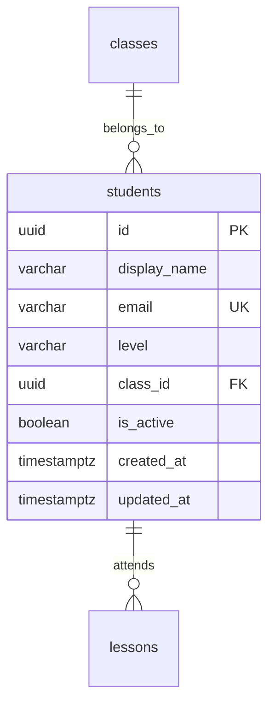

# `students` テーブル仕様書

## 1. 目的

語学学校のレッスンを受講する生徒の基本情報を管理するためのテーブル仕様を定義する。

この仕様書を `students` CRUD、レッスン登録時の生徒選択、レッスン一覧の生徒検索、Seedデータ作成の基準とする。対象は応募用MVPであり、受講料・出欠履歴・認証情報などの管理は含めない。

## 2. スコープ

### 保持する情報

- 生徒を識別するUUID
- 画面に表示する生徒名
- 任意のメールアドレス
- 学習レベル
- 所属クラス（MVPでは1人につき1クラス）
- 現在有効な生徒かどうか
- 登録日時・更新日時

### 保持しない情報

- パスワード、ログインセッション、権限
- 住所、電話番号、身分証番号
- 支払い情報、請求先情報
- レッスンごとの出欠や成績
- 日本語名・繁体字中国語名の別カラム
- 退会理由や変更履歴

氏名を日本語・繁体字中国語で分けて保持する必要が生じた場合は、`student_names` などの別設計を追加する。MVPでは単一の`display_name`で扱う。画面の表示言語は生徒データではなく、ログイン中のフロント設定で管理する。

## 3. テーブル概要

| 項目 | 内容 |
| --- | --- |
| テーブル名 | `students` |
| 用途 | 生徒マスタ |
| 主キー | `id` |
| 参照元 | `lessons.student_id`、`teacher_student_assignments.student_id` |
| 参照先 | `classes.id`（任意。1人につき最大1クラス） |
| 1レッスンとの関係 | 1人の生徒に対して0件以上のレッスン |
| 削除方針 | 物理削除しない。`is_active = false` にして非表示 |
| 個人情報方針 | 架空データのみ。公開環境に実在の生徒情報を登録しない |



## 4. カラム定義

| カラム | PostgreSQL型 | NULL | デフォルト | 制約・用途 |
| --- | --- | :---: | --- | --- |
| `id` | `uuid` | NO | `gen_random_uuid()` | 主キー。外部公開する識別子として使用 |
| `display_name` | `varchar(100)` | NO | なし | 画面に表示する名前。前後空白を除去し、空文字を禁止 |
| `email` | `varchar(255)` | YES | `NULL` | 連絡先または検索用。登録する場合は小文字で保持 |
| `level` | `varchar(30)` | YES | `NULL` | `beginner`、`intermediate`、`advanced` など。未設定を許可 |
| `class_id` | `uuid` | YES | `NULL` | `classes.id` へのFK。所属クラス。削除時は `NULL` |
| `is_active` | `boolean` | NO | `true` | 一覧・選択候補への表示可否 |
| `created_at` | `timestamptz` | NO | `now()` | 登録日時。UTCで保存 |
| `updated_at` | `timestamptz` | NO | `now()` | 最終更新日時。更新時に現在時刻へ更新 |

### 4.1 `id`

- UUID v4を使用する。
- DBのデフォルト値は `gen_random_uuid()` とする。
- CRUDのパスパラメータやレッスンの外部キーには、この値を使用する。
- `student_001` のような表示用文字列IDは使用しない。

### 4.2 `display_name`

- 必須項目。
- 最大100文字。
- API入力時に前後の空白を除去する。
- 空文字、空白だけの値は拒否する。
- 現時点では氏名の姓・名を分割しない。

### 4.3 `email`

- 任意項目。未登録は `NULL` とする。
- 最大255文字。
- API入力時に小文字化する。
- 基本形式はZodで検証する。
- MVPでは同一メールアドレスを重複登録しない。
- `NULL` は複数行で許可する。PostgreSQLの一意制約では `NULL` 同士は重複扱いにならない。

### 4.4 `level`

MVPでは自由な文字列ではなく、APIで次の値を基本値として検証する。

| 値 | 意味 |
| --- | --- |
| `beginner` | 初級 |
| `intermediate` | 中級 |
| `advanced` | 上級 |
| `NULL` | 未設定 |

将来、学校独自のレベル体系が必要になった場合は、`levels` マスターテーブルへの置き換えを検討する。

### 4.6 `is_active`

- 新規登録時は `true`。
- `false` の生徒は通常の生徒選択候補・一覧から除外する。
- 過去のレッスンから参照されている生徒は削除せず、`false` に更新する。
- 管理者が明示的に非表示を解除できるよう、更新APIでは変更可能にする。

### 4.7 `class_id`

- MVPでは生徒に所属クラスを1つだけ設定する。
- 未設定（`NULL`）を許可する。既存生徒を壊さず段階導入するためである。
- 新規登録・更新時に指定するクラスは、`classes.is_active = true` のものだけ許可する。
- クラス名はAPIで `className` として返し、生徒一覧・生徒詳細で表示する。
- 将来、複数クラス・受講期間・クラス変更履歴が必要になった場合は、`student_classes` 中間テーブルへ移行する。

## 5. DB制約

Drizzleスキーマでは次の制約を定義する。

```ts
export const students = pgTable(
  "students",
  {
    id: uuid("id").defaultRandom().primaryKey(),
    displayName: varchar("display_name", { length: 100 }).notNull(),
    email: varchar("email", { length: 255 }),
    level: varchar("level", { length: 30 }),
    isActive: boolean("is_active").notNull().default(true),
    createdAt: timestamp("created_at", { withTimezone: true })
      .notNull()
      .defaultNow(),
    updatedAt: timestamp("updated_at", { withTimezone: true })
      .notNull()
      .defaultNow(),
  },
  (table) => [
    uniqueIndex("students_email_unique").on(table.email),
    index("students_active_idx").on(table.isActive),
  ],
);
```

DBとAPIの責務を分ける。

| 検証内容 | 実施場所 |
| --- | --- |
| `id` のUUID・主キー | DB |
| `display_name` のNULL禁止・最大長 | DB + API |
| 空文字・前後空白 | API |
| `email` の一意性 | DB |
| `email` の形式・小文字化 | API |
| `level` の許可値 | API。将来マスターテーブル化 |
| `is_active` のboolean | DB |
| 更新時の `updated_at` | APIの更新処理 |

## 6. インデックスと検索方針

### 6.1 `students_email_unique`

- メールアドレスの重複を防止する。
- 生徒のメールアドレス検索にも利用する。
- `NULL` は複数件許可する。

### 6.2 `students_active_idx`

- `is_active = true` の生徒を選択候補として取得する処理に利用する。
- データ件数が少ないMVPでは効果が限定的だが、一覧APIの検索条件を明示するために作成する。

### 6.3 生徒一覧の検索条件

生徒一覧・選択候補では次の条件を使用する。

```sql
SELECT id, display_name, email, level, is_active,
       created_at, updated_at
FROM students
WHERE is_active = true
  AND (
    display_name ILIKE '%' || $1 || '%'
    OR email ILIKE '%' || $1 || '%'
  )
ORDER BY display_name ASC, id ASC
LIMIT $2 OFFSET $3;
```

- 検索文字列がない場合は、`display_name` と `id` の順に並べる。
- `pageSize` はAPI側で最大100に制限する。
- 全件取得を前提にせず、ページングする。
- `ILIKE` の検索量が大きくなった場合は、`pg_trgm` の導入または検索用インデックスを検討する。

## 7. CRUD時の業務ルール

### Create

- `display_name` は必須。
- `email` は任意。
- `level` は未指定を許可する。
- `is_active` は未指定なら `true`。
- 作成時に `created_at` と `updated_at` をDBのデフォルト値で設定する。

### Read

- 一覧のデフォルトは `is_active = true`。
- 管理用に `active=false` を指定した場合は非アクティブも検索できるようにする。
- 生徒詳細ではレッスン履歴の件数または一覧を返すことを将来検討する。
- 生徒一覧でパスワードや決済情報などの機密情報は返さない。

### Update

- `id` は変更不可。
- `display_name`、`email`、`level`、`class_id`、`is_active` を更新対象とする。
- 更新時は `updated_at` を現在時刻へ更新する。
- メールアドレス重複時は `409 DUPLICATE_RESOURCE` を返す。
- レッスン履歴が存在する生徒も更新可能とする。

### Delete

- MVPの通常CRUDでは物理削除を提供しない。
- 削除相当の操作は `is_active = false` への更新とする。
- `lessons.student_id` が参照するため、物理削除は外部キー制約で拒否される。
- 本当に削除が必要になった場合は、関連レッスン・監査ログ・個人情報削除の方針を先に決める。

## 8. API DTOとの対応

DBカラム名をそのまま公開せず、APIではcamelCaseに変換する。

| DB | API |
| --- | --- |
| `id` | `id` |
| `display_name` | `displayName` |
| `email` | `email` |
| `level` | `level` |
| `is_active` | `isActive` |
| `created_at` | `createdAt` |
| `updated_at` | `updatedAt` |

日本語名・繁体字中国語名の別フィールド（`nameJa`、`nameZhTw`）は、現在のテーブルには存在しないためMVPのAPIレスポンスには含めない。

## 9. Seedデータ

5件を投入し、一覧・検索・更新と先生ごとの担当範囲を確認できるようにする。

| display_name | level | is_active |
| --- | --- | --- | :---: |
| `Mina Lin` | `beginner` | true |
| `Yuki Mori` | `intermediate` | true |
| `Jun Huang` | `advanced` | true |
| `Emma Wang` | `beginner` | true |
| `Leo Nakamura` | `intermediate` | true |

Seedのメールアドレスには `example.test` を使用し、実在サービスへメールが送信されない値にする。

## 10. Migration・確認項目

テーブル作成時に次を確認する。

- `students` が作成されている。
- `id` がUUIDで自動生成される。
- `display_name` なしのINSERTが失敗する。
- 同一メールアドレスのINSERTが失敗する。
- `email = NULL` の複数INSERTは成功する。
- `is_active` のデフォルトが `true` になる。
- `lessons.student_id` から `students.id` を参照できる。
- レッスンから参照されている生徒の物理削除が失敗する。
- 生徒を `is_active = false` に更新しても、過去レッスンの参照が維持される。

## 11. 将来拡張

| 要件 | 拡張案 |
| --- | --- |
| 日本語名・繁体字中国語名を別々に保持 | `student_names` または多言語カラムを追加 |
| 住所・電話番号を管理 | 個人情報の保管目的、アクセス制御、削除方針を定義してから追加 |
| 学習履歴を管理 | `student_progress` を別テーブルで追加 |
| レベルを学校独自に管理 | `levels` マスターテーブルへ移行 |
| 退会・休学を区別 | `student_status` enumまたはステータス履歴を追加 |
| 操作履歴を管理 | `audit_logs` を追加し、更新前後の値を記録 |
