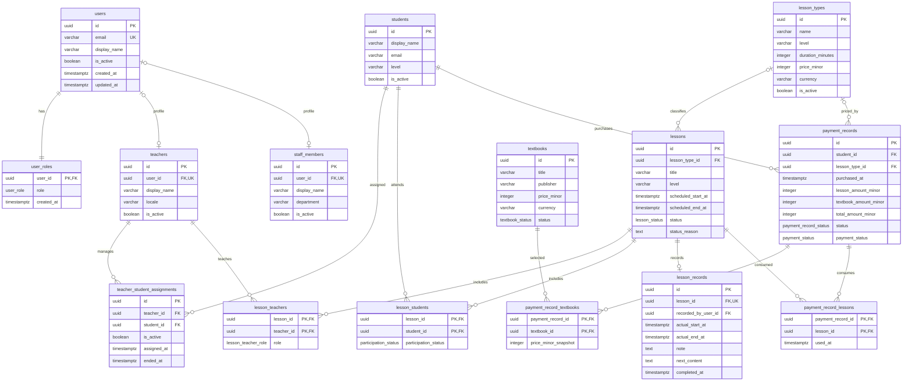

# テーブル関連図

## 1. 方針

この図は、現在のMVP実装から移行中のデータモデルを示す。新しい基盤テーブルは `api/drizzle/0001_simple_doctor_strange.sql` で追加済みである。

- `users` はログイン主体だけを管理する。
- `teachers`、`staff_members`、`students` は業務プロフィールとして分離する。
- ユーザーの権限は `user_roles` で管理し、現時点では1ユーザー1ロールに制限する。
- 講師と生徒の担当関係は `teacher_student_assignments` で明示する。
- 1レッスンに複数講師・複数生徒を紐付けるため、中間テーブルを使う。
- 授業メモと次回内容は、まずレッスン全体に対する `lesson_records` に保存する。

## 2. 目標ER図



## 3. 関係の意味

| 関係 | 意味 |
| --- | --- |
| `users` - `user_roles` | 1ユーザーに1つの権限を付与する。`user_roles.user_id` は一意 |
| `users` - `teachers` | ログイン可能な講師だけ紐付ける。デモ講師にも利用する |
| `users` - `staff_members` | スタッフとしてログインするユーザーを紐付ける |
| `teachers` - `teacher_student_assignments` - `students` | 現在の担当生徒と担当履歴を管理する |
| `lessons` - `lesson_teachers` | 1レッスンに複数講師を紐付ける。主担当・補助担当を持つ |
| `lessons` - `lesson_students` | 1レッスンに複数生徒を紐付ける。生徒ごとの参加状態を持つ |
| `lessons` - `lesson_records` | 1レッスンに授業記録を最大1件紐付ける |
| `students` - `payment_records` | 生徒ごとの5レッスン分の支払い記録を管理する |
| `payment_records` - `payment_record_lessons` - `lessons` | 完了したレッスンを生徒ごとの支払い記録から1回消費する |
| `payment_records` - `payment_record_textbooks` - `textbooks` | 1件の支払いに複数教科書を紐付ける |

## 4. 授業記録の単純化

現段階では `lesson_student_records` は作成しない。

`completed` への状態遷移時に、対象生徒ごとの `payment_record_lessons` を作成する。残り回数は5回から利用件数を引いて算出する。

```text
lesson_records
├── note          レッスン全体の授業メモ
└── next_content  レッスン全体の次回内容
```

グループレッスンで生徒ごとに異なるメモが必要になった場合だけ、後から次のテーブルを追加する。

```text
lesson_student_records
├── lesson_id
├── student_id
├── note
└── next_content
```

## 5. 現行実装からの移行

現在の `lessons` は `teacher_id` と `student_id` を直接持っている。目標構成へ移行する際は、次の順番で変更する。

1. `users`、`user_roles`、`staff_members` を追加する（完了）
2. `teacher_student_assignments` を追加する（完了）
3. `lesson_teachers` と `lesson_students` を追加する（完了）
4. 既存の `lessons.teacher_id` を `lesson_teachers` へ移行する（マイグレーションに含む）
5. 既存の `lessons.student_id` を `lesson_students` へ移行する（マイグレーションに含む）
6. APIを中間テーブル参照・配列形式へ変更する（完了）
7. 授業記録CRUDと講師別認可を追加する（完了）
8. ロールを `representative` / `teacher` / `staff` の1ユーザー1ロールへ統一する（完了）
9. フロントエンドを配列形式・セッション・授業記録へ対応させる（次の作業）
10. 旧カラムを非推奨化し、データ確認後に削除する（後続）

移行完了までは、既存の直接FKを残して後方互換性を維持する。
