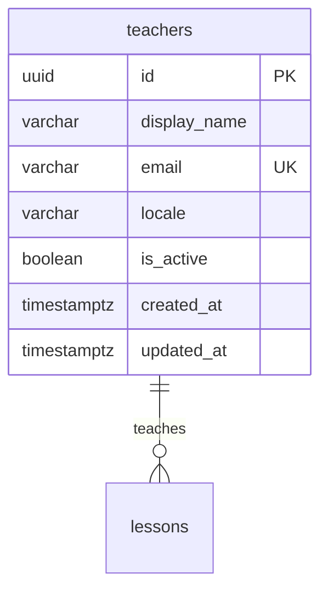

# `teachers` テーブル仕様書

## 1. 目的

語学学校のレッスンを担当する講師の基本情報を管理するためのテーブル仕様を定義する。

この仕様書を講師データのCRUD、レッスン登録時の講師選択、講師別実績集計、Seedデータ作成の基準とする。

## 2. スコープ

### 保持する情報

- 講師を識別するUUID
- 画面に表示する講師名
- 任意のメールアドレス
- 講師が利用する表示言語
- 現在有効な講師かどうか
- 登録日時・更新日時

### 保持しない情報

- パスワード、ログインセッション、権限
- 住所、電話番号、給与・契約情報
- 出退勤や休暇申請
- レッスンごとの授業実績
- 日本語名・繁体字中国語名の別カラム

## 3. テーブル概要

| 項目 | 内容 |
| --- | --- |
| テーブル名 | `teachers` |
| 用途 | 講師マスタ |
| 主キー | `id` |
| 参照元 | `lessons.teacher_id` |
| 1レッスンとの関係 | 1人の講師に対して0件以上のレッスン |
| 削除方針 | 物理削除しない。`is_active = false` にして非表示 |
| 個人情報方針 | 架空データのみ。公開環境に実在の講師情報を登録しない |



## 4. カラム定義

| カラム | PostgreSQL型 | NULL | デフォルト | 制約・用途 |
| --- | --- | :---: | --- | --- |
| `id` | `uuid` | NO | `gen_random_uuid()` | 主キー。外部公開する識別子として使用 |
| `display_name` | `varchar(100)` | NO | なし | 画面に表示する名前。前後空白を除去し、空文字を禁止 |
| `email` | `varchar(255)` | YES | `NULL` | 任意の連絡先。登録する場合は小文字で保持 |
| `locale` | `varchar(10)` | NO | `'ja'` | `ja` または `zh-TW`。講師向け表示言語 |
| `is_active` | `boolean` | NO | `true` | 講師選択候補・一覧への表示可否 |
| `created_at` | `timestamptz` | NO | `now()` | 登録日時。UTCで保存 |
| `updated_at` | `timestamptz` | NO | `now()` | 最終更新日時。更新時に現在時刻へ更新 |

## 5. DB制約・API検証

| 検証内容 | 実施場所 |
| --- | --- |
| `id` のUUID・主キー | DB |
| `display_name` のNULL禁止・最大長 | DB + API |
| 空文字・前後空白 | API |
| `email` の一意性 | DB |
| `email` の形式・小文字化 | API |
| `locale` の許可値（`ja` / `zh-TW`） | API |
| `is_active` のboolean | DB |
| 更新時の `updated_at` | APIの更新処理 |

講師がレッスンから参照されている場合は物理削除せず、`is_active = false` に更新する。`lessons.teacher_id` の外部キーは `RESTRICT` とし、過去のレッスン履歴を壊さない。

## 6. インデックスと検索方針

| インデックス | 用途 |
| --- | --- |
| `teachers_email_unique` | メールアドレスの重複防止・検索 |
| `teachers_active_idx` | 有効な講師の選択候補取得 |

講師一覧はデフォルトで `is_active = true` とし、氏名・メールアドレスの部分一致、ページング、表示名順で取得する。

```sql
SELECT id, display_name, email, locale, is_active,
       created_at, updated_at
FROM teachers
WHERE is_active = true
  AND (
    display_name ILIKE '%' || $1 || '%'
    OR email ILIKE '%' || $1 || '%'
  )
ORDER BY display_name ASC, id ASC
LIMIT $2 OFFSET $3;
```

## 7. CRUD時の業務ルール

### Create

- `display_name` は必須。
- `email` は任意。
- `locale` のデフォルトは `ja`。
- `is_active` は未指定なら `true`。

### Read

- 一覧のデフォルトは有効な講師のみ。
- 管理用に非アクティブ講師も検索できるようにする。
- 講師別実績画面では、講師情報と集計結果を別の責務として扱う。

### Update

- `id` は変更不可。
- `display_name`、`email`、`locale`、`is_active` を更新対象とする。
- 更新時は `updated_at` を現在時刻へ更新する。
- メールアドレス重複時は `409 DUPLICATE_RESOURCE` を返す。

### Delete

- MVPの通常CRUDでは物理削除を提供しない。
- 削除相当の操作は `is_active = false` への更新とする。
- レッスン履歴が存在する講師の物理削除は外部キー制約で拒否する。

## 8. API DTOとの対応

| DB | API |
| --- | --- |
| `id` | `id` |
| `display_name` | `displayName` |
| `email` | `email` |
| `locale` | `locale` |
| `is_active` | `isActive` |
| `created_at` | `createdAt` |
| `updated_at` | `updatedAt` |

## 9. Seedデータ

2件を投入し、先生2人のレッスン登録・講師検索・講師別集計を確認できるようにする。代表とスタッフは講師マスタには登録せず、`users` と `staff_members` で管理する。

| display_name | locale | is_active |
| --- | --- | :---: |
| `Aiko Tanaka` | `ja` | true |
| `Wei Chen` | `zh-TW` | true |

メールアドレスには `example.test` を使用し、実在サービスへメールが送信されない値にする。
